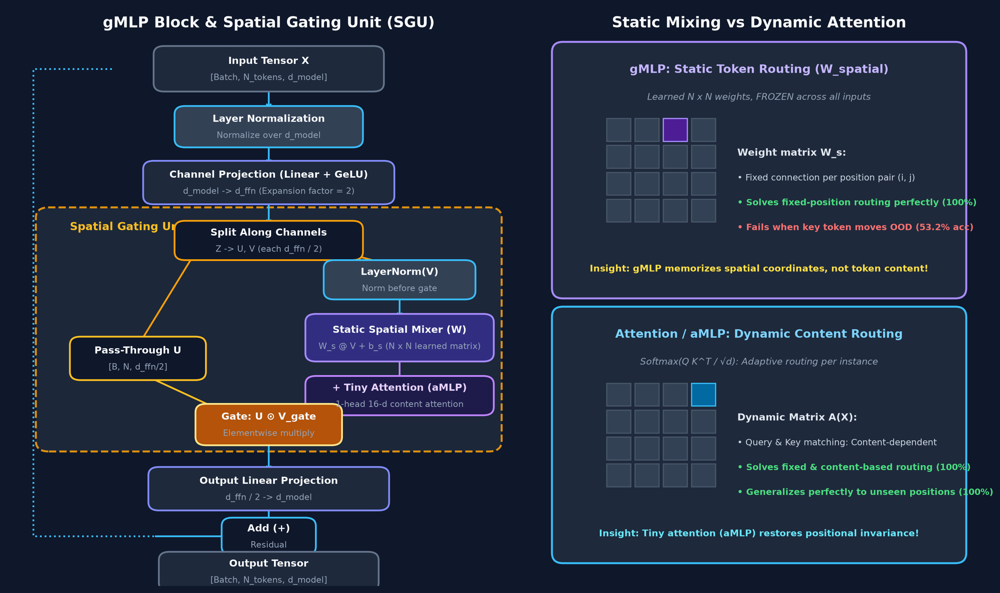
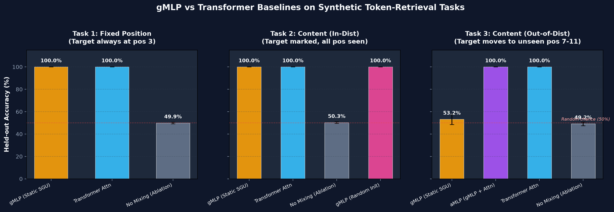
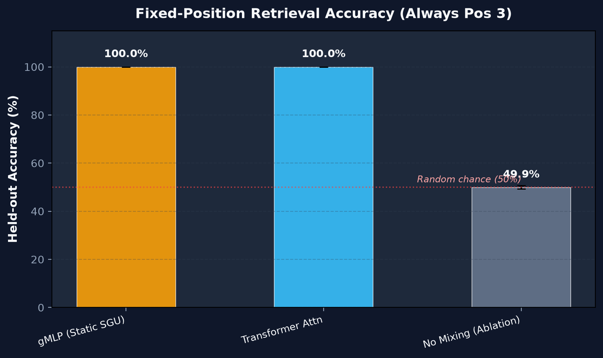
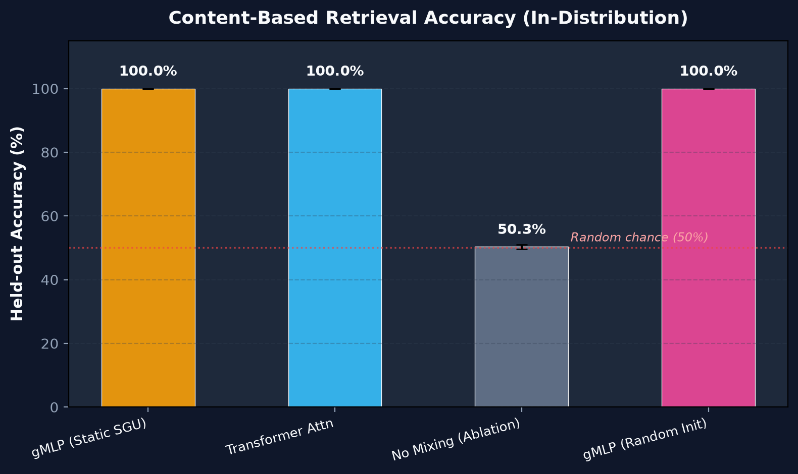
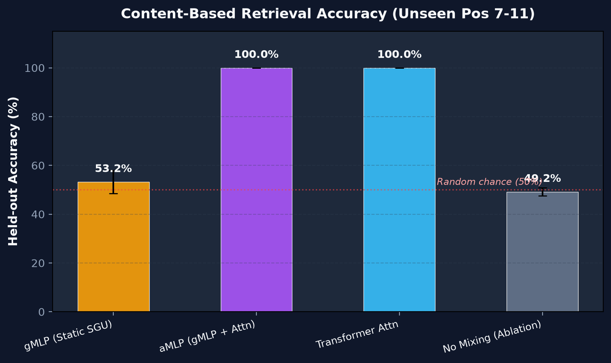

# gMLP: Spatial Gating, Static Token Mixing, and Tiny Attention

<div align="center">

[](https://www.python.org/)
[](https://pytorch.org/)
[]()
[](LICENSE)
[]()

*A clean, reproducible PyTorch study dissecting spatial gating, static coordinate routing vs. dynamic attention, and the inductive biases that make Transformers generalize.*

Inspired by **[Pay Attention to MLPs](https://arxiv.org/abs/2105.08050)** (Liu et al., Google Research, NeurIPS 2021) and the [labml.ai](https://nn.labml.ai/transformers/gmlp/index.html) implementation.

</div>

---

## Architecture Overview

Can a deep neural network select and route information across tokens without any self-attention mechanism? In 2021, Google Research demonstrated that a stack of gated multilayer perceptrons (**gMLP**) with static, learned spatial projection matrices can compete with Transformers on vision and masked-language modeling.

However, when tokens move to unfamiliar coordinates, static spatial weights face a fundamental inductive challenge.

<div align="center">
  
</div>

### The Core Mechanism: Spatial Gating Unit (SGU)

A gMLP layer replaces multi-head self-attention with a **Spatial Gating Unit (SGU)**:
1. **Channel Expansion:** The input $X \in \mathbb{R}^{B \times N \times d_{\text{model}}}$ is projected to $Z \in \mathbb{R}^{B \times N \times d_{\text{ffn}}}$ via a linear layer and GeLU activation.
2. **Channel Splitting:** The expanded tensor $Z$ is split in half along channels into $U, V \in \mathbb{R}^{B \times N \times (d_{\text{ffn}} / 2)}$.
3. **Static Token Mixing:** $V$ is normalized with LayerNorm and projected across the sequence dimension by a learned static matrix $W_s \in \mathbb{R}^{N \times N}$:
   $$\tilde{V} = W_s \text{LayerNorm}(V) + b_s$$
4. **Multiplicative Gating:** $U$ is elementwise multiplied by the gate $\tilde{V}$:
   $$\text{Output}_{\text{SGU}} = U \odot \tilde{V}$$
5. **Channel Contraction & Residual:** $\text{Output}_{\text{SGU}}$ is projected back to $d_{\text{model}}$ and added to $X$.

> **The SGU Identity Initialization Trick:**
> At step 0, $W_s$ is initialized with near-zero Gaussian noise ($\mathcal{N}(0, 10^{-4})$) and the bias $b_s$ is initialized to **$1.0$**. This ensures the gate starts as an identity pass-through: $U \odot (0 + 1) = U$, allowing gradients to flow effortlessly through 30+ layers without vanishing or exploding.

---

## Key Experimental Findings

We evaluated **gMLP**, **aMLP** (gMLP + single-head 16-d attention), **Transformer**, and ablations on three synthetic diagnostic retrieval tasks across multiple random seeds.

<div align="center">
  
</div>

### The Distribution Shift Dilemma

| Model | Parameters | Fixed Position | In-Distribution Content | Out-of-Distribution Content | Cross-Token Routing Mechanism |
| :--- | :---: | :---: | :---: | :---: | :--- |
| **gMLP** | **15,290** | **100.0%** | **100.0%** | **53.2%** *(Fails)* | Static spatial matrix $W_s \in \mathbb{R}^{N \times N}$ |
| **aMLP (gMLP + Tiny Attn)** | 21,626 | **100.0%** | **100.0%** | **100.0%** *(Recovers)* | Hybrid: Static $W_s$ + 1 tiny attention head |
| **Transformer Baseline** | 38,978 | **100.0%** | **100.0%** | **100.0%** | Multi-Head Self-Attention (4 heads) |
| **Random Init gMLP** | **15,290** | — | **100.0%** | — | $W_s \sim \text{Xavier}, b_s = 0$ |
| **No Mixing (Ablation)** | 15,290 | 49.9% | 50.3% | 49.2% | Frozen zero spatial matrix (Random chance) |

### Insights

- **Fixed-Position Routing:** When the target token is always at index 3, both gMLP and Transformer reach **100.0%** accuracy. gMLP achieves this with **61% fewer parameters** and zero quadratic attention overhead.
- **In-Distribution Content Selection:** When the target token is identified by a dynamic content marker (and all marker positions appear during training), gMLP still learns **100.0%** accuracy by configuring a dedicated cross-token pipeline for each position.
- **The Out-of-Distribution Collapse:** When marker positions 7–11 are held out during training and tested at evaluation:
  - **gMLP collapses to 53.2%** (random chance is 50.0%). Because $W_s$ learns fixed coordinate mappings, it cannot dynamically route tokens from unseen positions.
  - **aMLP recovers 100.0% accuracy** by augmenting the gate with just **one 16-dimensional attention head**.
  - **Transformer reaches 100.0%** because query-key dot products are inherently position-invariant and content-driven.

---

## Detailed Task Breakdown

<div align="center">
  <table>
    <tr>
      <td align="center"><b>Task 1: Fixed Position</b></td>
      <td align="center"><b>Task 2: Content (In-Distribution)</b></td>
    </tr>
    <tr>
      <td></td>
      <td></td>
    </tr>
    <tr>
      <td colspan="2" align="center"><b>Task 3: Content (Out-of-Distribution Shift)</b></td>
    </tr>
    <tr>
      <td colspan="2" align="center"></td>
    </tr>
  </table>
</div>

---

## Quick Start

No GPU, API keys, or external datasets required. CPU is fast and sufficient.

### 1. Installation

```bash
git clone https://github.com/AdityaInamdar334/gmlp_spatial_gating_lab.git
cd gmlp_spatial_gating_lab
python -m pip install -r requirements.txt
```

### 2. Run Test Suite

Verify tensor contracts, causal masking guarantees, and gradient properties:

```bash
python -m unittest discover -s tests -v
```

```text
test_content_labels (test_lab.DataTests.test_content_labels) ... ok
test_causal_gradient_no_future (test_lab.SGUTests.test_causal_gradient_no_future) ... ok
test_future_cannot_change_prefix (test_lab.SGUTests.test_future_cannot_change_prefix) ... ok
test_amlp_shape_and_mask (test_lab.SGUTests.test_amlp_shape_and_mask) ... ok
...
Ran 21 tests in 0.479s
OK
```

### 3. Run the SGU Interactive Demo

Check shape transformations and causal prefix independence:

```bash
python -m gmlp_lab.demo
```

```text
SGU input: (2, 6, 16) SGU output: (2, 6, 8)
Causal prefix absolute difference: 0.0
SGU init gate bias mean: 1.0
```

### 4. Run the Full Benchmark

Train all models across seeds and evaluate in-distribution and out-of-distribution:

```bash
python -m gmlp_lab.benchmark \
  --seeds 3 \
  --steps 140 \
  --batch-size 96 \
  --eval-size 768 \
  --output results/benchmark.json
```

### 5. Generate Visualizations

Rebuild all high-resolution figures:

```bash
python plot_results.py
```

---

## Causal Masking & Autoregressive Decoding

Can gMLP be used for autoregressive language generation?

Yes, but **only if strict causal masking is applied**. In a standard feedforward layer, token positions cannot look ahead. But in gMLP, the spatial matrix $W_s$ mixes all tokens bidirectionally:

```python
# Unmasked spatial mixing allows position 0 to read position 10!
gate = W_s @ V + b_s
```

To prevent future tokens from leaking information into past representations, we apply a lower-triangular visibility mask $\mathcal{M}$:

```python
if mask is not None:
    W_masked = self.weight * mask
else:
    W_masked = self.weight

spatial = torch.einsum("mn, bnd -> bmd", W_masked, v) + self.bias
```

Our test suite explicitly enforces this with two analytical invariants:
1. **Perturbation Test:** Perturbing future inputs $X_{t > k}$ results in exactly **$0.0$** change in earlier outputs $\hat{Y}_{\le k}$.
2. **Gradient Test:** Backpropagating from an earlier output step produces **$\frac{\partial Y_{\le k}}{\partial X_{t > k}} = 0$** everywhere.

---

## Project Structure

```text
gmlp_spatial_gating_lab/
├── README.md                 # Project documentation & visual guide
├── ARTICLE.md                # Comprehensive technical tutorial & deep dive
├── BENCHMARK_NOTES.md        # Experimental configuration & environment records
├── requirements.txt          # Minimal Python dependencies (torch, matplotlib)
├── LICENSE                   # MIT License
├── plot_results.py           # Publication-ready figure generator
├── figures/                  # High-resolution benchmark figures
│   ├── architecture_diagram.png
│   ├── benchmark_summary.png
│   ├── fixed_accuracy.png
│   ├── content_accuracy.png
│   └── content_ood_accuracy.png
├── gmlp_lab/                 # Core library modules
│   ├── __init__.py
│   ├── models.py             # SpatialGatingUnit, GMLPBlock, GMLP, aMLP, Transformer
│   ├── data.py               # Deterministic synthetic retrieval datasets
│   ├── benchmark.py          # Multi-seed training loop and evaluation CLI
│   └── demo.py               # Quick interactive demonstration script
├── tests/
│   └── test_lab.py           # 21 unit tests: shapes, causality, gradients, smoke tests
└── results/
    ├── benchmark.json        # Raw per-seed evaluation records & aggregations
    └── run.log               # Benchmark run logs
```

---

## Primary References

1. Hanxiao Liu, Zihang Dai, David R. So, Quoc V. Le. **[Pay Attention to MLPs](https://arxiv.org/abs/2105.08050)**. *NeurIPS 2021*.
2. **[labml.ai Annotated gMLP Implementation](https://nn.labml.ai/transformers/gmlp/index.html)**.
3. Ross Wightman. **[timm: PyTorch Image Models](https://github.com/huggingface/pytorch-image-models/blob/main/timm/models/mlp_mixer.py)**.

---

## License

This repository is licensed under the [MIT License](LICENSE).
